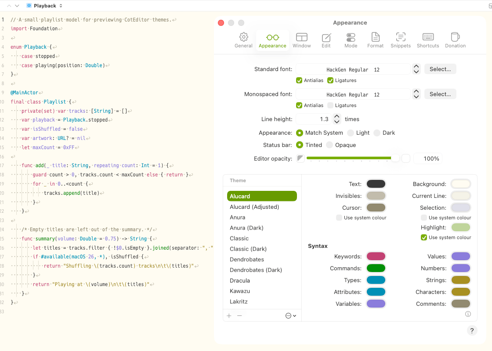
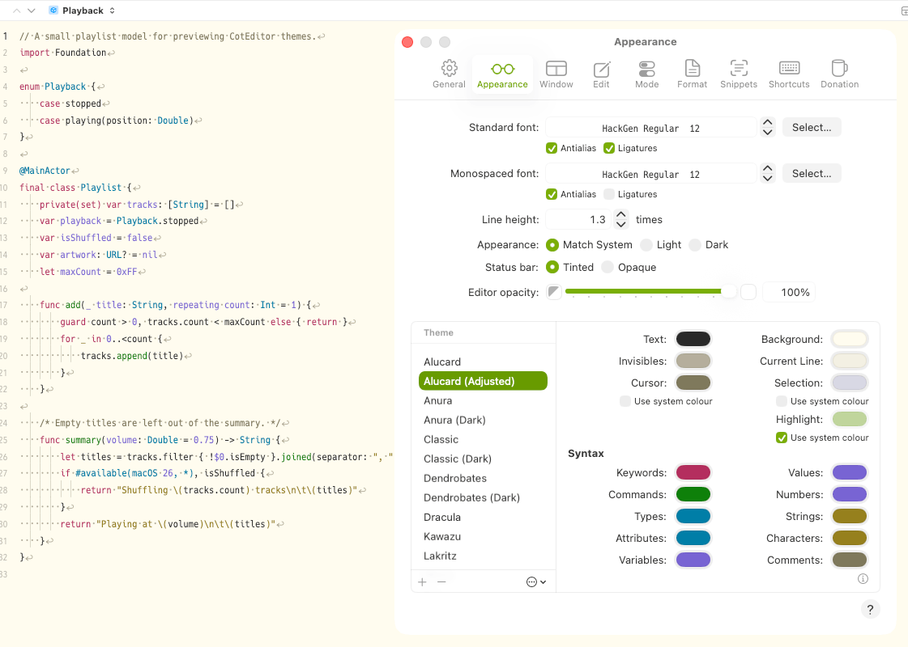
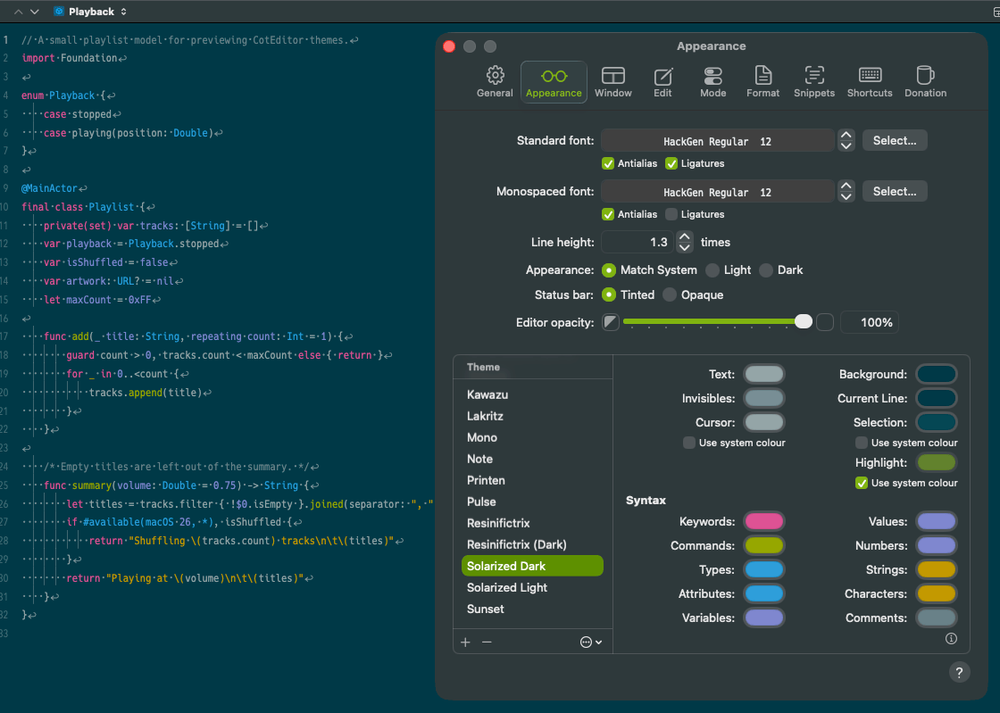
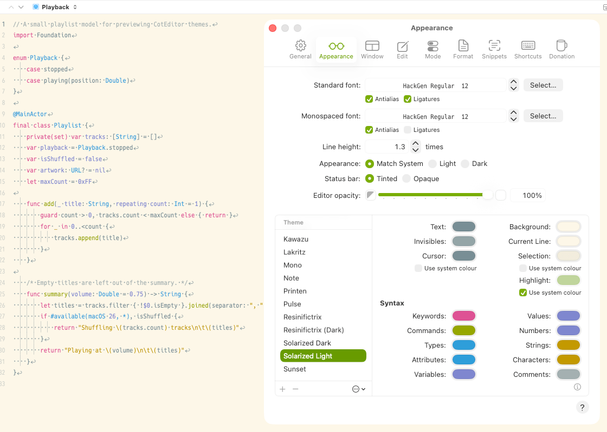
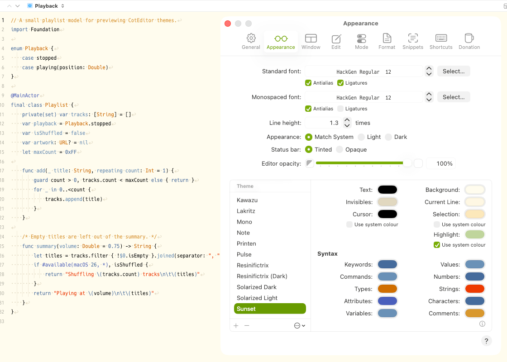

# CotEditor テーマ集

[English](README.md)

macOS 向けテキストエディタ [CotEditor](https://coteditor.com/) のカラーテーマです。

| テーマ | 外観 | ベース |
| --- | --- | --- |
| [Alucard](Alucard.cottheme) | ライト | Dracula テーマのライト版パレット [Alucard](https://draculatheme.com/spec) |
| [Alucard (Adjusted)](Alucard%20%28Adjusted%29.cottheme) | ライト | Alucard の色を CotEditor の色空間に合わせて調整したもの |
| [Solarized Dark](Solarized%20Dark.cottheme) | ダーク | Ethan Schoonover 氏の [Solarized](https://ethanschoonover.com/solarized/) |
| [Solarized Light](Solarized%20Light.cottheme) | ライト | Ethan Schoonover 氏の [Solarized](https://ethanschoonover.com/solarized/) |
| [Sunset](Sunset.cottheme) | ライト | Xcode に同梱の Sunset テーマを CotEditor 向けに変換したもの |

### Alucard と Alucard (Adjusted) の違い

CotEditor はテーマファイルの 16 進カラーコードを Generic RGB として解釈します。一方、Alucard のパレットは sRGB の値で公開されています。

- **Alucard** は公開されている値をそのまま使っているため、パレットより少し明るく表示されます。
- **Alucard (Adjusted)** は値を変換してあり、パレットどおりの色で表示されます。

## インストール

1. 使いたい `.cottheme` ファイルをダウンロードするか、このリポジトリをクローンします。
2. CotEditor で「CotEditor」＞「設定」を選択し、「外観」をクリックします。
3. 次のどちらかの方法で読み込みます。
   - 「テーマ」リストの下にあるその他のボタンをクリックして「読み込む」を選択し、ファイルを選びます。
   - ファイルを Finder から「テーマ」リストへドロップします。
4. 「テーマ」リストで読み込んだテーマを選択します。

## スクリーンショット

表示しているコードは [samples/Sample.swift](samples/Sample.swift) です。

### Alucard

### Alucard (Adjusted)

### Solarized Dark

### Solarized Light

### Sunset

## ライセンス

このリポジトリのテーマファイルは [MIT ライセンス](LICENSE)で配布します。

ベースにした配色の権利は、それぞれの作者に帰属します。

- **Solarized**: MIT License, Copyright (c) 2011 Ethan Schoonover
- **Dracula / Alucard**: MIT License, Copyright (c) 2023 Dracula Theme
- **Sunset**: 元のテーマは Xcode の一部です。このプロジェクトは Apple Inc. とは関係がなく、同社の承認を受けたものでもありません。Xcode は Apple Inc. の商標です。
