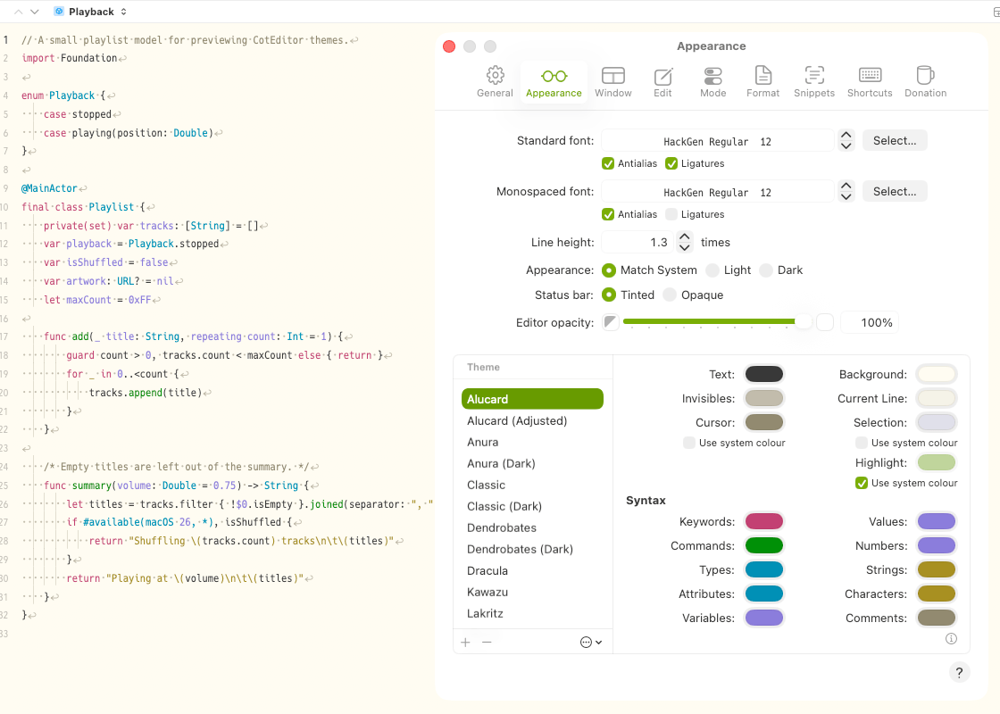
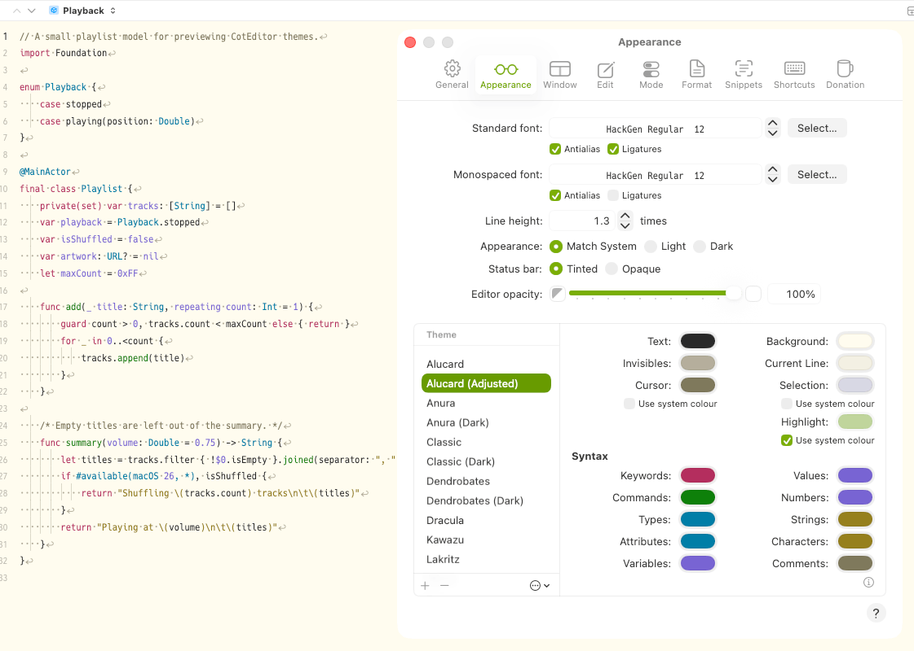
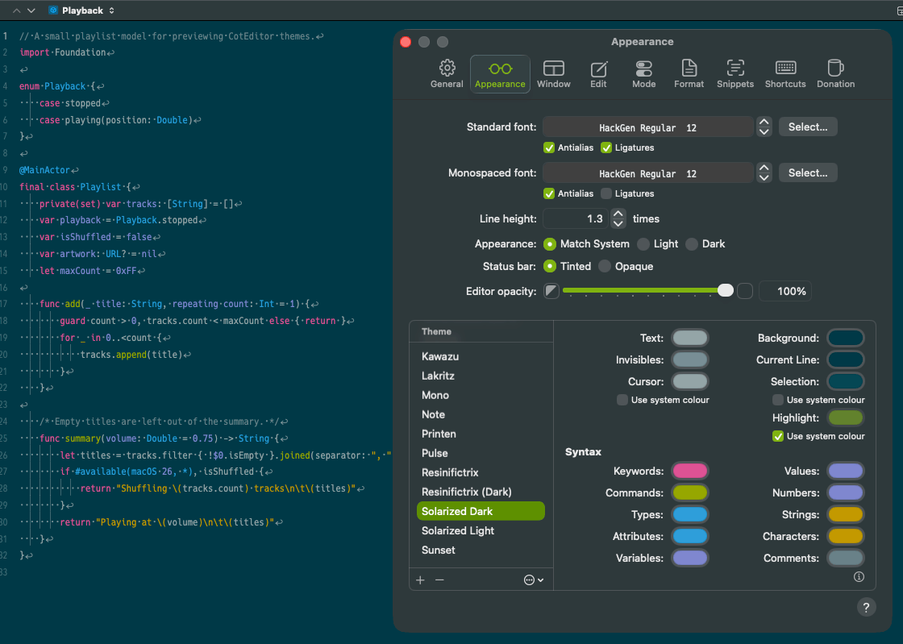
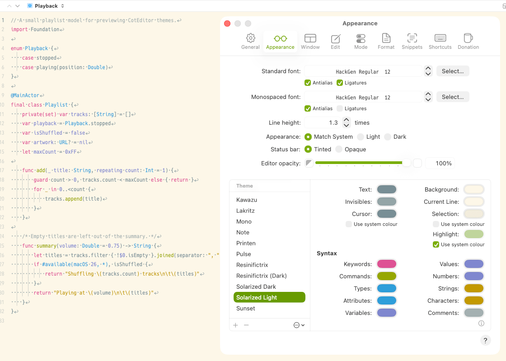
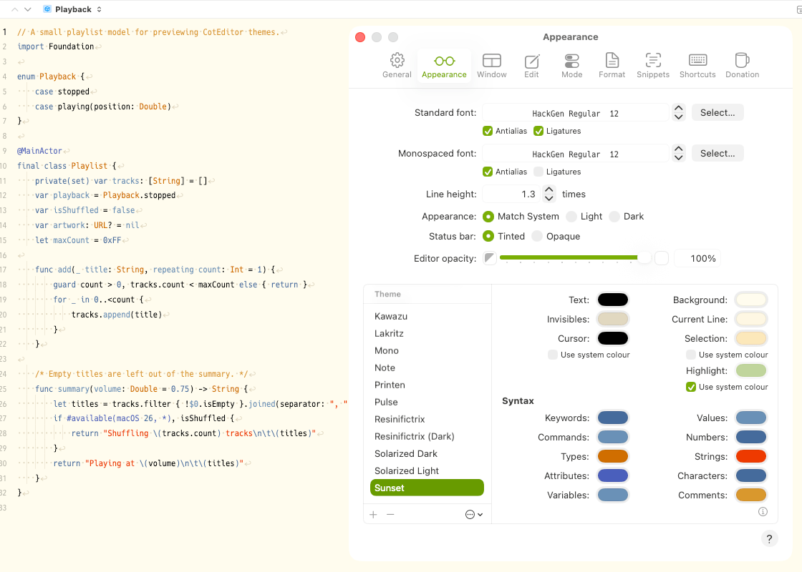

# CotEditor Themes

[日本語](README.ja.md)

Color themes for [CotEditor](https://coteditor.com/), the plain-text editor for macOS.

| Theme | Appearance | Based on |
| --- | --- | --- |
| [Alucard](Alucard.cottheme) | Light | [Alucard](https://draculatheme.com/spec), the light palette of the Dracula theme |
| [Alucard (Adjusted)](Alucard%20%28Adjusted%29.cottheme) | Light | Same as Alucard, with values adjusted for CotEditor's color space |
| [Solarized Dark](Solarized%20Dark.cottheme) | Dark | [Solarized](https://ethanschoonover.com/solarized/) by Ethan Schoonover |
| [Solarized Light](Solarized%20Light.cottheme) | Light | [Solarized](https://ethanschoonover.com/solarized/) by Ethan Schoonover |
| [Sunset](Sunset.cottheme) | Light | The Sunset theme bundled with Xcode, converted for CotEditor |

### Alucard or Alucard (Adjusted)?

CotEditor reads the hex values in a theme file as Generic RGB, while the Alucard palette is published as sRGB hex values.

- **Alucard** uses the published hex values as they are, so its colors appear slightly lighter than the palette.
- **Alucard (Adjusted)** uses converted values so that its colors appear as the palette defines them.

## Installation

1. Download the `.cottheme` file you want, or clone this repository.
2. In CotEditor, choose **CotEditor > Settings**, then click **Appearance**.
3. Do one of the following:
   - Click the **More** button below the Theme list, choose **Import**, then select the file.
   - Drag the file from the Finder into the Theme list.
4. Select the imported theme in the Theme list.

## Screenshots

The code shown is [samples/Sample.swift](samples/Sample.swift).

### Alucard

### Alucard (Adjusted)

### Solarized Dark

### Solarized Light

### Sunset

## License

[MIT](LICENSE), covering the theme files in this repository.

The color schemes these themes are based on belong to their respective authors:

- **Solarized**: MIT License, Copyright (c) 2011 Ethan Schoonover
- **Dracula / Alucard**: MIT License, Copyright (c) 2023 Dracula Theme
- **Sunset**: the original theme is part of Xcode. This project is not affiliated with or endorsed by Apple Inc. Xcode is a trademark of Apple Inc.
